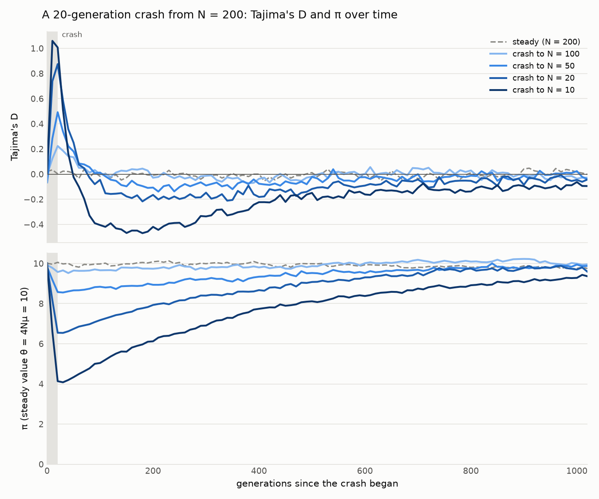

# 02-120-Project: Population crashes, growth and genetic variation

**Research question:** Does a rapid population crash or rapid growth change the genetic
variation of later generations? If so, how long does the effect last?

This project simulates genetic drift and mutation with the Wright-Fisher model, samples DNA
sequences from the simulated populations, and measures genetic variation with nucleotide
diversity (π), Watterson's θ and Tajima's D (Tajima 1989). Each crash or growth scenario is
compared with a steady control population to see when the two can no longer be told apart.

## Results so far

A 20-generation crash from N = 200 (200 simulated populations per line):



- During a crash, D jumps positive (rare variants are lost first). It then drops *below* zero
  and climbs back slowly, as new mutations accumulate in the recovering population.
- π falls during the crash and takes hundreds of generations to recover.
- The more severe the crash, the longer the effect lasts. A 20-generation crash to N = 10
  is still detectable roughly 800 generations later for D and 950 for π.

Twenty generations of rapid growth from N = 200:


- D turns negative (growth adds many new, rare mutations) and stays negative for over
  1,000 generations. The bigger the growth, the more negative D gets.
- π rises slowly toward the larger population's new equilibrium, 4N·μ, which takes
  about 4N generations to reach.

Recovery times vary by up to about a hundred generations from one random seed to the next,
and depend on the number of simulated populations (more populations can detect smaller
leftover differences), so they should be compared at the same settings.

## Setup

Requires Python 3.10 or newer.

```bash
python3 -m venv .venv          # on Debian/Ubuntu, first: sudo apt install python3-venv
.venv/bin/pip install -r requirements.txt
```

## Running

| Command | What it does | Time |
|---|---|---|
| `.venv/bin/python plots.py` | Makes both figures in `figures/` | ~1 min |
| `.venv/bin/python plots.py crash` | Only the crash figure | ~15 s |
| `.venv/bin/python plots.py growth` | Only the growth figure | ~50 s |
| `.venv/bin/python recovery.py` | Prints recovery times for crashes of several sizes | ~20 s |
| `.venv/bin/python diversity.py` | Prints average Tajima's D over time for steady, crash and growth | ~5 s |
| `.venv/bin/python infinite_sites.py` | Runs one population to equilibrium and prints its variation | <1 s |
| `.venv/bin/python wright_fisher.py` | Single-locus drift demos | <1 s |

## Tests

```bash
.venv/bin/python -m unittest -v test_wright_fisher test_infinite_sites test_diversity test_recovery
```

The 33 tests take about 10 seconds. Besides unit tests with hand-worked answers, they check
the simulation against population-genetics theory:

- A neutral allele fixes with probability equal to its starting frequency.
- Heterozygosity shrinks by a factor of (1 − 1/2N) each generation, through a crash.
- With mutation, total heterozygosity follows H′ = (1 − 1/2N)(H + 2μ) and levels off at 4Nμ − 2μ.
- In a steady population, E[π] = E[θ_W] = 4Nμ and Tajima's D averages about 0.
- Tajima's D is positive just after a crash and negative after rapid growth.

## How it works

| File | Contents |
|---|---|
| `wright_fisher.py` | One locus, two alleles: one generation of drift, population size histories (`make_crash_history`, `make_growth_history`), fixation probability. Also holds the shared random number generator (`set_seed`). |
| `infinite_sites.py` | Many sites under the infinite-sites model: every mutation hits a new site. `sites_generation_many` advances many independent populations in one NumPy call. |
| `diversity.py` | Samples n sequences without replacement and computes S, π, θ_W and Tajima's D. `average_sample_stats` averages them over many populations at chosen generations. |
| `recovery.py` | Compares event populations with one steady control and finds the recovery time: the first generation after which they stay within 4 standard errors of each other. |
| `plots.py` | Draws the figures above. |

Each simulation starts with no variation and runs a burn-in of 10N generations at the normal
size, so variation reaches equilibrium before the crash or growth begins.

Each file starts with pseudocode for its main functions.

## Reference

Tajima, Fumio. "Statistical Method for Testing the Neutral Mutation Hypothesis by DNA
Polymorphism." *Genetics*, vol. 123, no. 3, 1989, pp. 585–595.
https://doi.org/10.1093/genetics/123.3.585
