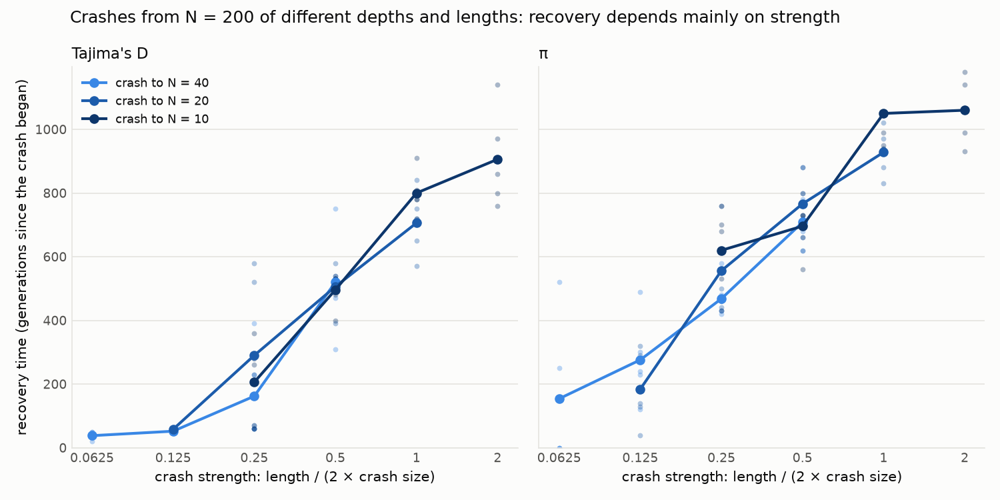
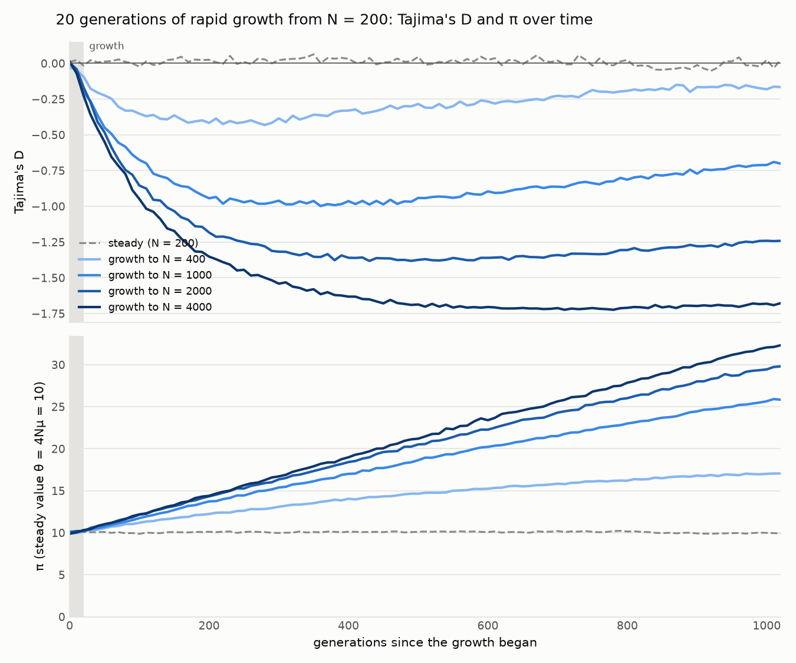
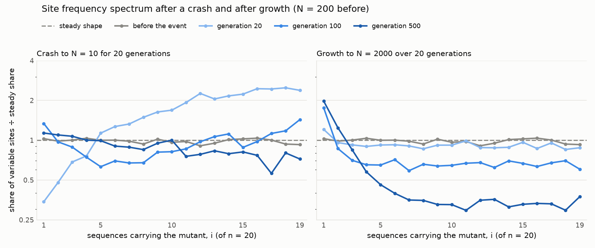
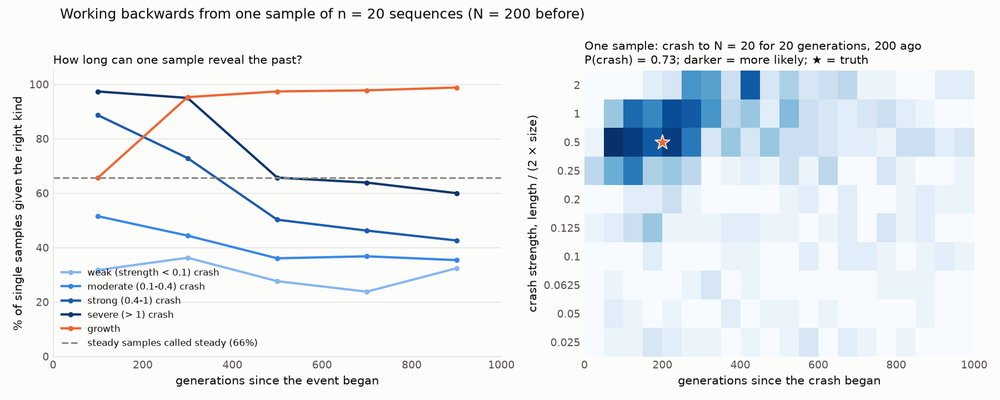

# 02-120-Project: Population crashes, growth and genetic variation

**Research question:** Does a rapid population crash or rapid growth change the genetic
variation of later generations? If so, how long does the effect last?

This project simulates genetic drift and mutation with the Wright-Fisher model, samples DNA
sequences from the simulated populations, and measures genetic variation with nucleotide
diversity (π), Watterson's θ and Tajima's D (Tajima 1989). Each crash or growth scenario is
compared with a steady control population to see when the two can no longer be told apart.

## Results so far

A 20-generation crash from N = 200 (200 simulated populations per line):


- During a crash, D jumps positive (rare variants are lost first). It then drops *below* zero
  and climbs back slowly, as new mutations accumulate in the recovering population.
- π falls during the crash and takes hundreds of generations to recover.
- The dotted lines are π predicted by theory alone, with no simulation: each generation
  at size N keeps a share (1 − 1/2N) of the variation, and mutation adds 2μ
  (`expected_sample_pi`). The simulated π follows them closely, which is a check that
  the simulation is right.
- The more severe the crash, the longer the effect lasts. A 20-generation crash to N = 10
  is still detectable roughly 800 generations later for D and 950 for π.

How recovery time depends on crash size (5 random seeds of 200 populations each; dots are
single seeds, lines are averages; times are also saved in `figures/recovery_vs_crash_size.csv`):


- Halving the population (N = 100) for 20 generations barely registers: D recovers within
  about 40 generations, and the drop in π is too small to detect.
- Below that, recovery time rises steeply with severity, then levels off around
  600–700 generations for D and 950 for π for crashes to N = 15 or less.
- π takes longer to recover than D for every crash size that π can detect.

Is a short, severe crash worse than a long, mild one? Crashes to N = 40, 20 and 10 lasting
5, 10, 20 or 40 generations, plotted against crash strength, length / (2 × crash size)
(times also saved in `figures/recovery_vs_crash_strength.csv`):



- Crashes with the same strength take about the same time to recover from, whatever their
  depth. For example, at strength 0.5 (N = 40 for 40 generations, N = 20 for 20, or N = 10
  for 10), D recovers after 520, 506 and 496 generations, and π after 708, 766 and 696.
- This matches theory: each generation at size N multiplies heterozygosity by (1 − 1/2N),
  so a crash of length L at size N_c removes about the same variation whenever L / 2N_c
  is the same.
- So what matters is the strength of the crash, not its depth or length alone: a brief,
  severe crash and a long, mild one of equal strength leave the same mark.

Twenty generations of rapid growth from N = 200:



- D turns negative (growth adds many new, rare mutations) and stays negative for over
  1,000 generations. The bigger the growth, the more negative D gets.
- π rises slowly toward the larger population's new equilibrium, 4N·μ, which takes
  about 4N generations to reach. Again it follows the theory (dotted lines) closely.

How long does growth leave a mark? After growth the population stays large, so it can never
look like the old steady population again (its π settles permanently higher). Instead, each
grown population is compared with a steady control that has *always* been at the new size:
it has recovered once it looks like it was always that large. Growth from N = 200 to 300,
400, 600 and 1000 over 20 generations, followed for 10 × the new size (5 random seeds of
200 populations each; times also saved in `figures/recovery_vs_growth_size.csv`):


| Grow to | D recovers (generations, mean ± SD) | π recovers (generations, mean ± SD) |
|---|---|---|
| 300 (1.5×) | 753 ± 162 | 1107 ± 147 |
| 400 (2×) | 1536 ± 160 | 1864 ± 89 |
| 600 (3×) | 3168 ± 826 | 3450 ± 268 |
| 1000 (5×) | 5570 ± 250 | 6520 ± 485 |

- Growth leaves a mark far longer than a crash. Even the most severe crash recovered within
  about 950 generations; growth to N = 1000 takes about 5,600 (D) and 6,500 (π).
- The new size sets the pace. The missing variation fills in by a factor of about
  (1 − 1/2N) per generation at the new size N, so a large population takes a long time to
  build up the variation it should have. Recovery takes about 2.5–6.5 × the new size.
- Bigger jumps take longer even after dividing by the new size (right panel). Part of this is
  biology (a bigger jump leaves a bigger gap to fill), and part is measurement: larger
  populations have more variable sites, so their averages are less noisy and smaller
  leftover gaps can be detected.
- As after crashes, π takes longer to recover than D.

### Why D moves: the site frequency spectrum

Tajima's D compares π, which is driven by variants at middle frequencies, with θ_W, which
counts every variable site and so is driven by rare ones. The site frequency spectrum shows
both at once: how many variable sites are carried by 1, 2, ..., n − 1 of the n sampled
sequences. In a steady population, a site carried by i sequences is expected in
proportion to 1/i. The figure divides each class's share of variable sites by that steady
share, so a steady population lies along 1 (500 populations, n = 20):



- Before either event, the spectrum lies along 1, as theory predicts.
- **At the end of a crash** (generation 20), singletons are at about 0.35 × their steady
  share and common variants at about 2 ×: the crash lost the rare variants first. Too few
  rare variants makes D positive.
- **After the crash** (generation 100), the tilt reverses: singletons are *above* their
  steady share (1.34 ×) and middle frequencies below it. The crash removed most of the old
  variation, and every new mutation starts as a singleton, so new rare variants make up
  more of what is left. This is why D dips below zero while the population recovers.
- **After growth**, singletons climb to 1.8 × their steady share by generation 100 and 2 ×
  by generation 500, while every other class falls below 1. A large population gains many
  new mutations each generation, and they have not had time to drift to higher
  frequencies. This is the negative D.

Recovery times vary by up to about a hundred generations from one random seed to the next
after crashes (more after growth, up to several hundred),
and depend on the number of simulated populations (more populations can detect smaller
leftover differences), so they should be compared at the same settings.

### Working backwards: what happened to this population?

The results above run forwards: given a history, what does variation look like? A real
study works backwards: it has **one sample** of sequences and asks what happened.
`inference.py` answers this with Approximate Bayesian Computation (ABC):

1. **Reference table.** Simulate 200 populations for each of 21 histories (steady; crashes
   to N = 10, 20, 40 or 100 lasting 5, 10, 20 or 40 generations; growth to N = 400, 1000,
   2000 or 4000 over 20 generations), and sample each one every 10 generations for 1000
   generations. This gives 424,200 samples whose history is known. The time since the
   event costs nothing extra: one simulation, sampled at many times, covers them all.
2. **Compare.** Each sample is summarized by π, S and the number of singletons, which
   together capture the shape of the site frequency spectrum. Each is divided by its spread
   among steady samples, so the three are on a common scale.
3. **Keep the closest.** The 500 reference samples nearest the observed one show which
   histories could have produced it. Steady, crash and growth start with equal odds.

To test it, 9,000 reference samples (3,000 each of steady, crash and growth) were each
treated as an observation, and their history was inferred from the rest of the table, after
removing every sample from the same simulated population so no near-copy was left to find:



- **Severe crashes are clear; mild ones are invisible.** Crashes of strength above 1 are
  recognized 98% of the time in the first 300 generations, strong ones (0.4–1) 84%, but
  moderate (0.1–0.4) and weak (below 0.1) ones only 48% and 34%. A mild crash leaves a sample
  that looks steady, so a third of truly steady samples are also blamed on mild crashes
  (66% are called steady).
- **The crash signal fades** as the population recovers, in line with the recovery times
  above. **Growth gets easier to see with time** (75% in the first 300 generations, 98%
  after 600), because the excess of rare variants keeps building.
- **Strength, not depth or length.** In the worked example (right), the most likely cells
  are at the true strength, 0.5. The method can estimate the strength
  length / (2 × crash size), but not the depth and length separately, as the crash
  strength results above predict.
- **The uncertainty is honest.** The 90% ranges contain the true crash strength 97% of the
  time and the true time since the event 92% of the time. Single samples are noisy, though:
  the typical error in time since a crash is about 220 generations (80 after growth).

Two limits: the reference table assumes the sample was taken with the same N, μ and n,
and, like the rest of this project, that sites drift independently (see the app section).

## Setup

Requires Python 3.10 or newer.

```bash
python3 -m venv .venv          # on Debian/Ubuntu, first: sudo apt install python3-venv
.venv/bin/pip install -r requirements.txt
```

## Interactive app

```bash
.venv/bin/streamlit run app.py
```

This opens the app in your browser. It has two modes, chosen at the top of the sidebar.

**Explore an event.** Pick a steady, crash or growth history in the sidebar
(normal and event population size, event length, mutation rate, sample size, number of
populations), then press **Run simulation** (about 5–30 seconds; a progress bar shows how far
it has got, and settings that were already simulated come back at once). The app simulates the
event alongside a steady control and shows:

- **Averages over time:** Tajima's D, π, θ_W and S averaged over the populations, with the
  generation at which the event can no longer be told apart from the control. For π, dotted
  lines show the theory's prediction.
- **Site frequency spectrum:** an animation of the spectrum of the event and the control,
  relative to a steady population's (as in the figure above). Press **▶ Play** to watch
  rare variants vanish during a crash and return as the population recovers, or drag the
  slider. A small chart of population size above it marks the generation shown.
- **Single samples:** how often one sample from one population has a D outside the middle
  95% of D values in the steady control, and an animated histogram of D across populations
  over time.
- **Data:** the numbers behind the charts, including the theory's π.

**Work backwards.** Infers the history from one sample (see above). Either let the app
simulate a **mystery population** (it picks a random history and shows one sample's π, S
and singletons; press **Reveal the truth** afterwards), or **enter your own numbers**. The
app shows the chance of steady, crash and growth, the likely strength (or size after
growth) and time since the event, and a heat map of the possibilities. The reference table
for these settings is included in `inference_cache/`, so this mode starts at once; tables for
other settings take about a minute to build and are then saved there too.

The simulation lets every site drift independently, as if sites were unlinked. This gives
the right averages, but D varies less from population to population than Tajima's test
assumes (it assumes linked sites with no recombination). Tajima's standard limits would
therefore almost never flag a sample, so the app takes its limits from the simulated
steady control instead. The app shows Tajima's limits alongside for comparison.

## Running

| Command | What it does | Time |
|---|---|---|
| `.venv/bin/python plots.py` | Makes all seven figures in `figures/` | ~16 min |
| `.venv/bin/python plots.py crash` | Only the crash figure | ~15 s |
| `.venv/bin/python plots.py growth` | Only the growth figure | ~50 s |
| `.venv/bin/python plots.py severity` | Only the recovery time vs. crash size figure, plus its CSV | ~1 min |
| `.venv/bin/python plots.py length` | Only the crash length vs. depth figure, plus its CSV | ~2 min |
| `.venv/bin/python plots.py growthsize` | Only the recovery time vs. growth size figure, plus its CSV | ~10 min |
| `.venv/bin/python plots.py sfs` | Only the site frequency spectrum figure | ~25 s |
| `.venv/bin/python plots.py inference` | Only the working-backwards figure | ~1.5 min (+45 s the first time) |
| `.venv/bin/python inference.py` | Builds the reference table, infers four mystery populations and prints the validation | ~1 min (+45 s the first time) |
| `.venv/bin/python recovery.py` | Prints recovery times for crashes of several sizes | ~20 s |
| `.venv/bin/python diversity.py` | Prints average Tajima's D over time for steady, crash and growth | ~5 s |
| `.venv/bin/python infinite_sites.py` | Runs one population to equilibrium and prints its variation | <1 s |
| `.venv/bin/python wright_fisher.py` | Single-locus drift demos | <1 s |

Times are for an 8-core computer. The severity, length and growthsize figures repeat their
experiment with 5 random seeds, which run at the same time on different CPU cores; with
fewer cores they take longer, but give exactly the same results.

## Tests

```bash
.venv/bin/python -m unittest -v test_wright_fisher test_infinite_sites test_diversity test_recovery test_inference test_app test_animation
```

The 86 tests take about 30 seconds. Besides unit tests with hand-worked answers, they check
the simulation against population-genetics theory:

- A neutral allele fixes with probability equal to its starting frequency.
- Heterozygosity shrinks by a factor of (1 − 1/2N) each generation, through a crash.
- With mutation, total heterozygosity follows H′ = (1 − 1/2N)(H + 2μ) and levels off at 4Nμ − 2μ.
- In a steady population, E[π] = E[θ_W] = 4Nμ and Tajima's D averages about 0.
- Tajima's D is positive just after a crash and negative after rapid growth.
- The 5% limits of Tajima's test are near ±1.96 for large samples and widen at stricter levels.
- Limits taken from one set of steady populations flag about 5% of a new set.
- After growth, π recovers against a control at the new size but never against one at the old size.
- The theory for π (`expected_sample_pi`) equals 4Nμ at equilibrium and matches simulated
  samples through a crash.
- In a steady population the site frequency spectrum matches θ/i in every class; just
  after a crash singletons are too few, and during growth too many.
- Running seeds in parallel gives exactly the same recovery times as running them one
  after another.
- The app runs even when a crash leaves fewer gene copies than the usual sample size:
  the sample size is limited to 2N during a crash (`test_app.py` drives the real app), and
  shows both animations, also when the same settings are run again.
- Each animation has one frame per recorded generation, fixed axes, and frames that
  match the simulated numbers.
- Working backwards finds a recent severe crash and large growth from single samples, and
  gives each kind 1/3 prior odds even though the grid has more crash histories.

## How it works

| File | Contents |
|---|---|
| `wright_fisher.py` | One locus, two alleles: one generation of drift, population size histories (`make_crash_history`, `make_growth_history`), fixation probability. Also holds the shared random number generator (`set_seed`). |
| `infinite_sites.py` | Many sites under the infinite-sites model: every mutation hits a new site. `sites_generation_many` advances many independent populations in one NumPy call. `expected_sample_pi` predicts the average π for any population size history from theory alone. |
| `diversity.py` | Samples n sequences without replacement and computes S, π, θ_W and Tajima's D. `average_sample_stats` averages them over many populations at chosen generations; `sample_stats_per_trial` keeps each population's values. `tajima_critical_values` gives the limits of Tajima's test, and `control_limits` the limits from simulated steady populations. `sample_stats_and_sfs` also averages the site frequency spectrum, and `sfs_ratio` compares its shape with a steady population's. |
| `recovery.py` | Compares event populations with one steady control and finds the recovery time: the first generation after which they stay within 4 standard errors of each other. The control can be a different size from the starting population (`control_size`), which `growth_recovery_times` uses to compare grown populations with a control at the new size. `run_in_parallel` runs independent seeds on separate CPU cores; each seed sets its own random numbers, so the results are the same as running them one after another. |
| `inference.py` | Works backwards from one sample: builds the reference table (`build_reference_table`, saved in `inference_cache/`), keeps the closest simulated samples (`infer`), summarizes them (`summarize`) and tests the method on samples with known histories (`validate`). |
| `plots.py` | Draws the figures above. |
| `app.py` | The interactive Streamlit app. |
| `animation.py` | Builds the app's animated Plotly charts (the site frequency spectrum and the spread of D over time), with play and pause buttons, a slider and a time marker. |

Each simulation starts with no variation and runs a burn-in of 10N generations at the normal
size, so variation reaches equilibrium before the crash or growth begins.

Each file starts with pseudocode for its main functions.

## Reference

Tajima, Fumio. "Statistical Method for Testing the Neutral Mutation Hypothesis by DNA
Polymorphism." *Genetics*, vol. 123, no. 3, 1989, pp. 585–595.
https://doi.org/10.1093/genetics/123.3.585
