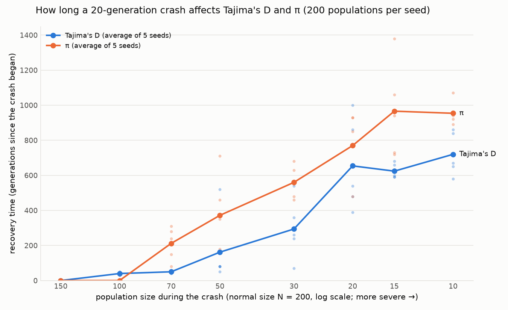
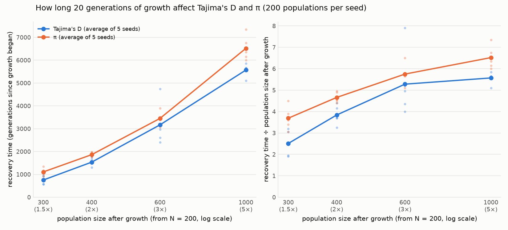

# 02-120-Project: Population crashes, growth and genetic variation

**Research question:** Does a rapid population crash or rapid growth change the genetic
variation of later generations? If so, how long does the effect last?

This project simulates genetic drift and mutation with the Wright-Fisher model, samples DNA
sequences from the simulated populations, and measures genetic variation with nucleotide
diversity (π), Watterson's θ and Tajima's D (Tajima 1989). Each crash or growth scenario is
compared with a steady control population to see when the two can no longer be told apart.

## Results so far

A 20-generation crash from N = 200 (200 simulated populations per line):


- During a crash, D jumps positive (rare variants are lost first). It then drops *below* zero
  and climbs back slowly, as new mutations accumulate in the recovering population.
- π falls during the crash and takes hundreds of generations to recover.
- The more severe the crash, the longer the effect lasts. A 20-generation crash to N = 10
  is still detectable roughly 800 generations later for D and 950 for π.

How recovery time depends on crash size (5 random seeds of 200 populations each; dots are
single seeds, lines are averages; times are also saved in `figures/recovery_vs_crash_size.csv`):



- Halving the population (N = 100) for 20 generations barely registers: D recovers within
  about 40 generations, and the drop in π is too small to detect.
- Below that, recovery time rises steeply with severity, then levels off around
  600–700 generations for D and 950 for π for crashes to N = 15 or less.
- π takes longer to recover than D for every crash size that π can detect.

Is a short, severe crash worse than a long, mild one? Crashes to N = 40, 20 and 10 lasting
5, 10, 20 or 40 generations, plotted against crash strength, length / (2 × crash size)
(times also saved in `figures/recovery_vs_crash_strength.csv`):


- Crashes with the same strength take about the same time to recover from, whatever their
  depth. For example, at strength 0.5 (N = 40 for 40 generations, N = 20 for 20, or N = 10
  for 10), D recovers after 520, 506 and 496 generations, and π after 708, 766 and 696.
- This matches theory: each generation at size N multiplies heterozygosity by (1 − 1/2N),
  so a crash of length L at size N_c removes about the same variation whenever L / 2N_c
  is the same.
- So what matters is the strength of the crash, not its depth or length alone: a brief,
  severe crash and a long, mild one of equal strength leave the same mark.

Twenty generations of rapid growth from N = 200:


- D turns negative (growth adds many new, rare mutations) and stays negative for over
  1,000 generations. The bigger the growth, the more negative D gets.
- π rises slowly toward the larger population's new equilibrium, 4N·μ, which takes
  about 4N generations to reach.

How long does growth leave a mark? After growth the population stays large, so it can never
look like the old steady population again (its π settles permanently higher). Instead, each
grown population is compared with a steady control that has *always* been at the new size:
it has recovered once it looks like it was always that large. Growth from N = 200 to 300,
400, 600 and 1000 over 20 generations, followed for 10 × the new size (5 random seeds of
200 populations each; times also saved in `figures/recovery_vs_growth_size.csv`):



| Grow to | D recovers (generations, mean ± SD) | π recovers (generations, mean ± SD) |
|---|---|---|
| 300 (1.5×) | 753 ± 162 | 1107 ± 147 |
| 400 (2×) | 1536 ± 160 | 1864 ± 89 |
| 600 (3×) | 3168 ± 826 | 3450 ± 268 |
| 1000 (5×) | 5570 ± 250 | 6520 ± 485 |

- Growth leaves a mark far longer than a crash. Even the most severe crash recovered within
  about 950 generations; growth to N = 1000 takes about 5,600 (D) and 6,500 (π).
- The new size sets the pace. The missing variation fills in by a factor of about
  (1 − 1/2N) per generation at the new size N, so a large population takes a long time to
  build up the variation it should have. Recovery takes about 2.5–6.5 × the new size.
- Bigger jumps take longer even after dividing by the new size (right panel). Part of this is
  biology (a bigger jump leaves a bigger gap to fill), and part is measurement: larger
  populations have more variable sites, so their averages are less noisy and smaller
  leftover gaps can be detected.
- As after crashes, π takes longer to recover than D.

Recovery times vary by up to about a hundred generations from one random seed to the next
after crashes (more after growth, up to several hundred),
and depend on the number of simulated populations (more populations can detect smaller
leftover differences), so they should be compared at the same settings.

## Setup

Requires Python 3.10 or newer.

```bash
python3 -m venv .venv          # on Debian/Ubuntu, first: sudo apt install python3-venv
.venv/bin/pip install -r requirements.txt
```

## Interactive app

```bash
.venv/bin/streamlit run app.py
```

This opens the app in your browser. Pick a steady, crash or growth history in the sidebar
(normal and event population size, event length, mutation rate, sample size, number of
populations), then press **Run simulation** (about 5–30 seconds). The app simulates the
event alongside a steady control and shows:

- **Averages over time:** Tajima's D, π, θ_W and S averaged over the populations, with the
  generation at which the event can no longer be told apart from the control.
- **Single samples:** how often one sample from one population has a D outside the middle
  95% of D values in the steady control, and a histogram of D across populations at any
  chosen generation.
- **Data:** the numbers behind the charts.

The simulation lets every site drift independently, as if sites were unlinked. This gives
the right averages, but D varies less from population to population than Tajima's test
assumes (it assumes linked sites with no recombination). Tajima's standard limits would
therefore almost never flag a sample, so the app takes its limits from the simulated
steady control instead. The app shows Tajima's limits alongside for comparison.

## Running

| Command | What it does | Time |
|---|---|---|
| `.venv/bin/python plots.py` | Makes all five figures in `figures/` | ~33 min |
| `.venv/bin/python plots.py crash` | Only the crash figure | ~15 s |
| `.venv/bin/python plots.py growth` | Only the growth figure | ~50 s |
| `.venv/bin/python plots.py severity` | Only the recovery time vs. crash size figure, plus its CSV | ~3 min |
| `.venv/bin/python plots.py length` | Only the crash length vs. depth figure, plus its CSV | ~4 min |
| `.venv/bin/python plots.py growthsize` | Only the recovery time vs. growth size figure, plus its CSV | ~25 min |
| `.venv/bin/python recovery.py` | Prints recovery times for crashes of several sizes | ~20 s |
| `.venv/bin/python diversity.py` | Prints average Tajima's D over time for steady, crash and growth | ~5 s |
| `.venv/bin/python infinite_sites.py` | Runs one population to equilibrium and prints its variation | <1 s |
| `.venv/bin/python wright_fisher.py` | Single-locus drift demos | <1 s |

## Tests

```bash
.venv/bin/python -m unittest -v test_wright_fisher test_infinite_sites test_diversity test_recovery
```

The 46 tests take about 20 seconds. Besides unit tests with hand-worked answers, they check
the simulation against population-genetics theory:

- A neutral allele fixes with probability equal to its starting frequency.
- Heterozygosity shrinks by a factor of (1 − 1/2N) each generation, through a crash.
- With mutation, total heterozygosity follows H′ = (1 − 1/2N)(H + 2μ) and levels off at 4Nμ − 2μ.
- In a steady population, E[π] = E[θ_W] = 4Nμ and Tajima's D averages about 0.
- Tajima's D is positive just after a crash and negative after rapid growth.
- The 5% limits of Tajima's test are near ±1.96 for large samples and widen at stricter levels.
- Limits taken from one set of steady populations flag about 5% of a new set.
- After growth, π recovers against a control at the new size but never against one at the old size.

## How it works

| File | Contents |
|---|---|
| `wright_fisher.py` | One locus, two alleles: one generation of drift, population size histories (`make_crash_history`, `make_growth_history`), fixation probability. Also holds the shared random number generator (`set_seed`). |
| `infinite_sites.py` | Many sites under the infinite-sites model: every mutation hits a new site. `sites_generation_many` advances many independent populations in one NumPy call. |
| `diversity.py` | Samples n sequences without replacement and computes S, π, θ_W and Tajima's D. `average_sample_stats` averages them over many populations at chosen generations; `sample_stats_per_trial` keeps each population's values. `tajima_critical_values` gives the limits of Tajima's test, and `control_limits` the limits from simulated steady populations. |
| `recovery.py` | Compares event populations with one steady control and finds the recovery time: the first generation after which they stay within 4 standard errors of each other. The control can be a different size from the starting population (`control_size`), which `growth_recovery_times` uses to compare grown populations with a control at the new size. |
| `plots.py` | Draws the figures above. |
| `app.py` | The interactive Streamlit app. |

Each simulation starts with no variation and runs a burn-in of 10N generations at the normal
size, so variation reaches equilibrium before the crash or growth begins.

Each file starts with pseudocode for its main functions.

## Reference

Tajima, Fumio. "Statistical Method for Testing the Neutral Mutation Hypothesis by DNA
Polymorphism." *Genetics*, vol. 123, no. 3, 1989, pp. 585–595.
https://doi.org/10.1093/genetics/123.3.585
